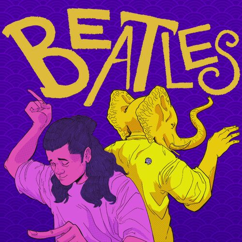

# 🎸 Firoze Jong

[](https://github.com/BD-Band-Archive/BD-Band-Music) [](#) [](#) [](#)

<p align="center">
  
</p>

## 🌟 About the Band

> **Firoze Jong** is an iconic Dhaka-based indie rock and psychedelic pop outfit. Known for their whimsical storytelling, satirical wit, lush arrangements, and catchy melodies, Firoze Jong has built a passionate cult following across Bangladesh's modern alternative rock ecosystem.

🎵 **Stream Lossless Audio Online:** [BD Band Music Player](https://bd-band-music.pages.dev/) &bull; [Mirror](https://bd-band-music.netlify.app/)

---

## 📑 Discography Index

1. [Singles & Standalone Releases](#1-singles--standalone-releases)

---

<a id="1-singles--standalone-releases"></a>
## 1. Singles & Standalone Releases

- **Artist:** Firoze Jong
- **Release Year:** Standalone Releases
- **Audio Quality:** Lossless FLAC (16-bit / 44.1 kHz)

<p align="center">
  
</p>

### 📖 About the Album
A curated collection of Firoze Jong's viral and celebrated standalone singles, showcasing their quirky blend of comedic satire, introspective poetics, and bright indie guitars across hits such as *"Aaste"*, *"Depression"*, *"Ghengor"*, *"Half Glass Carew"*, and *"Ong Bong Chhong"*.

### 🎵 Tracklist (One-Tap Download)

- [**01. Aaste**](https://media.githubusercontent.com/media/BD-Band-Archive/Firoze-Jong/master/Singles/Aaste.flac?download=true) &nbsp; [](https://media.githubusercontent.com/media/BD-Band-Archive/Firoze-Jong/master/Singles/Aaste.flac?download=true)
- [**02. Brishti**](https://media.githubusercontent.com/media/BD-Band-Archive/Firoze-Jong/master/Singles/Brishti.flac?download=true) &nbsp; [](https://media.githubusercontent.com/media/BD-Band-Archive/Firoze-Jong/master/Singles/Brishti.flac?download=true)
- [**03. Depression**](https://media.githubusercontent.com/media/BD-Band-Archive/Firoze-Jong/master/Singles/Depression.flac?download=true) &nbsp; [](https://media.githubusercontent.com/media/BD-Band-Archive/Firoze-Jong/master/Singles/Depression.flac?download=true)
- [**04. Firoze Jong**](https://media.githubusercontent.com/media/BD-Band-Archive/Firoze-Jong/master/Singles/Firoze_Jong.flac?download=true) &nbsp; [](https://media.githubusercontent.com/media/BD-Band-Archive/Firoze-Jong/master/Singles/Firoze_Jong.flac?download=true)
- [**05. Ghengor**](https://media.githubusercontent.com/media/BD-Band-Archive/Firoze-Jong/master/Singles/Ghengor.flac?download=true) &nbsp; [](https://media.githubusercontent.com/media/BD-Band-Archive/Firoze-Jong/master/Singles/Ghengor.flac?download=true)
- [**06. Half Glass Carew**](https://media.githubusercontent.com/media/BD-Band-Archive/Firoze-Jong/master/Singles/Half%20Glass%20Carew.flac?download=true) &nbsp; [](https://media.githubusercontent.com/media/BD-Band-Archive/Firoze-Jong/master/Singles/Half%20Glass%20Carew.flac?download=true)
- [**07. Ong Bong Chhong**](https://media.githubusercontent.com/media/BD-Band-Archive/Firoze-Jong/master/Singles/Ong%20Bong%20Chhong.flac?download=true) &nbsp; [](https://media.githubusercontent.com/media/BD-Band-Archive/Firoze-Jong/master/Singles/Ong%20Bong%20Chhong.flac?download=true)

### 🖼️ Album Artwork

| | |
| :---: | :---: |
| <br><sub><b>1. Beatles Cover</b></sub> | <br><sub><b>2. Aaste Cover</b></sub> |
| <br><sub><b>3. Depression Cover</b></sub> | <br><sub><b>4. Ghengor Cover</b></sub> |
| <br><sub><b>5. Half Glass Carew Cover</b></sub> | <br><sub><b>6. Ong Bong Chhong Cover</b></sub> |

---

### 💾 Git LFS & Downloading Audio
All audio tracks in this repository are managed via **Git LFS** (Large File Storage).
- **One-Tap Direct Download:** Click either the track title or the green download button next to any song to instantly save the file to your device.
- **To clone locally with all audio files:**
  ```bash
  git lfs install
  git clone https://github.com/BD-Band-Archive/Firoze-Jong.git
  ```

---

### 🤝 Contribution & DMCA Notice
All songs and archival materials in this repository were collected and curated from various internet sources, physical CD rips, and public community archives for cultural preservation and historical documentation.

- **Contributions:** If you have physical CD or cassette rips in lossless FLAC format, missing booklet/inlay scans, or tracklist metadata corrections, contributions and pull requests are warmly welcome!
- **DMCA / Copyright Notice:** If this repository contains your copyrighted or DMCA-protected files and you wish to have them removed, please contact:
  - **Email:** [maniruzzamanmridul@gmail.com](mailto:maniruzzamanmridul@gmail.com)
  
  Please provide the specific track, album, or file details, and the requested material will be reviewed and removed as soon as possible.
